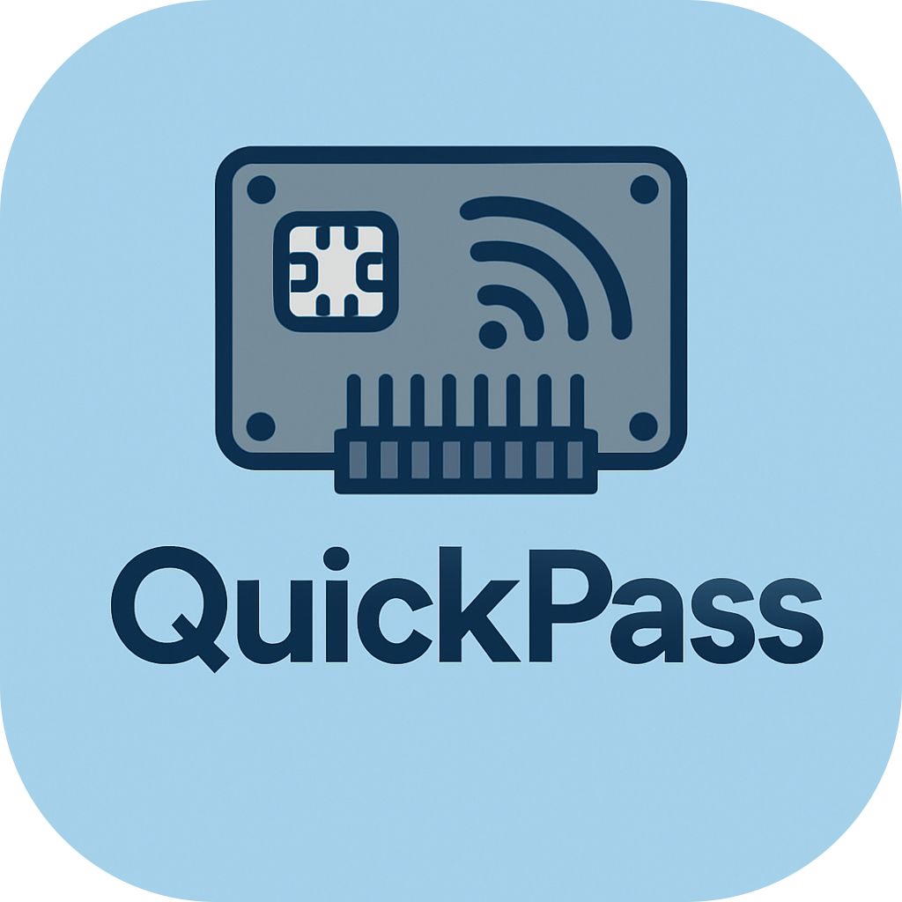
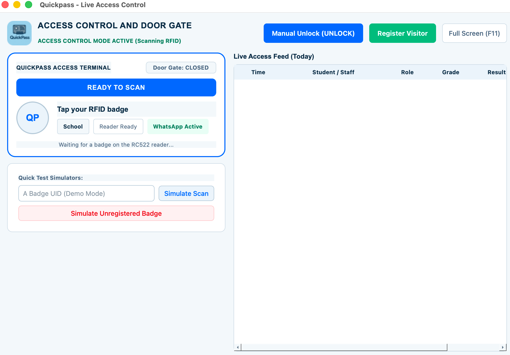
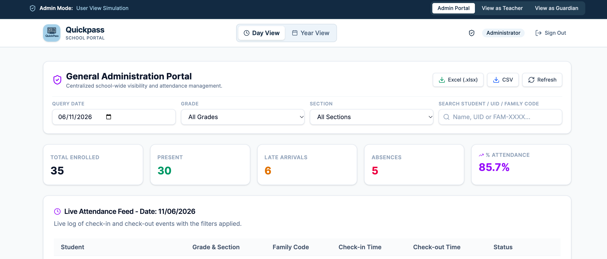

<p align="center">
  
</p>

<h1 align="center">Quickpass</h1>

<p align="center">
  School attendance and access control with RFID Badges.
</p>

<p align="center">
  <a href="https://github.com/JnDarkLord/Quickpass/actions/workflows/ci.yml"></a>
  <a href="LICENSE"></a>
  
  
</p>

A Student taps their Badge at the School's entrance. The Door Gate opens, the Check-in is recorded as On Time or Late, and the Student's Guardians get a text message. Staff manage Badges, search attendance, and export official Excel reports from a desktop window. Guardians, Teachers, and Admins can follow attendance in an optional web portal.

Each School runs Quickpass in Spanish or English, from the window to the gate's screen to the portal.

## Features

- **Door Gate:** an Arduino Uno with an RC522 RFID reader, a 16x2 LCD, status LEDs, and a stepper motor that opens the gate.
- **Check-ins and Check-outs:** On Time or Late against the School's Late Threshold, with Repeat Scans that open the gate without being recorded.
- **Offline first:** each station decides every scan from its own database, so the Door Gate keeps working without the internet.
- **Guardian messages:** text or WhatsApp messages through Twilio when a Student checks in and out.
- **Admin Approval:** protected changes need an Admin's Badge, or the School's Admin Secret Key in its place.
- **The School's own structure:** its Grades, Sections, school weekdays, and holidays. Absences count only on School Days.
- **Reports:** Excel workbooks for a day, a person, a Grade, a Section, a date range, or staff and visitors (reports E1 to E8).
- **Grade Promotion:** the end-of-year move up one Grade, with final-Grade Students becoming Graduates.
- **Web portal:** a Day View and a Year View for Guardians (their own children), Teachers (their Grade), and Admins (the whole School), on Supabase.

Quickpass focuses strictly on entrance attendance, physical gate access, Guardian arrival and departure notifications, and attendance reports. It intentionally stays out of grades, assignments, tuition billing, and camera or biometric tracking.

## How it fits together



The desktop program is the heart of a station: it shows the window, talks to the Arduino, decides each scan, and sends the messages. Cloud Sync copies the station's records to Supabase, where the web portal reads them. A School can run without Supabase, keeping everything on the station. [Architecture](docs/architecture.md) explains each part.





## Hardware

| Part | Quantity |
|:---|:---|
| Arduino Uno R3, or a compatible board | 1 |
| RC522 RFID reader (13.56 MHz, 3.3 V) | 1 |
| RFID Badges: MIFARE Classic cards or keyfobs | 1 per person |
| 16x2 LCD with an I2C backpack (address `0x27` or `0x3F`) | 1 |
| 28BYJ-48 stepper motor (5 V) with a ULN2003 driver board | 1 |
| Red and green LEDs, with 220 Ω to 330 Ω resistors | 1 each |
| Regulated 5 V, 1 A power supply, for the motor | 1 |
| Breadboard, jumper wires, and a USB cable | |
| A Windows or macOS computer for the station | 1 |

The [Hardware Guide](docs/hardware.md) has the wiring, the pinout, and the firmware upload.

## Getting started

1. **Build the Door Gate** and upload the firmware: [Hardware Guide](docs/hardware.md).
2. **Install the desktop program** and complete first-run setup: [Desktop Setup](docs/desktop-setup.md).
3. **Optionally, set up Supabase and the web portal**: [Web Portal Setup](docs/web-portal-setup.md).
4. **Run the School**: Badges, reports, settings, and the Grade Promotion: [School Administration](docs/school-administration.md).

To try the desktop program without hardware, on macOS or Linux:

```bash
python3 -m venv .venv
source .venv/bin/activate
pip install -r requirements.txt
cp .env.example .env
DEMO_MODE=true DATABASE_PATH=demo.db python main_program/main.py
```

Or run `make setup && make demo` from the repository root. Quickpass needs Python 3.10 or newer. [Desktop Setup](docs/desktop-setup.md) covers Windows and every `.env` setting.

## Documentation

| Guide | For |
|:---|:---|
| [Hardware Guide](docs/hardware.md) | The parts, the wiring, and uploading the firmware |
| [Desktop Setup](docs/desktop-setup.md) | Installing the desktop program, `.env`, and first-run setup |
| [Web Portal Setup](docs/web-portal-setup.md) | Supabase, its Auth settings, and publishing the portal |
| [School Administration](docs/school-administration.md) | Badges, the School Settings, reports, and the Grade Promotion |
| [Architecture](docs/architecture.md) | How the parts work together, the serial protocol, and the portal's security |
| [Testing](docs/testing.md) | Running the Python, portal, and firmware tests |
| [Contributing](CONTRIBUTING.md) | Proposing changes, branch rules, and translations |
| [Security Policy](SECURITY.md) | Reporting security issues privately and deployment boundaries |
| [Code of Conduct](CODE_OF_CONDUCT.md) | Community standards for contributors and maintainers |
| [Changelog](CHANGELOG.md) | Notable changes across releases |

## Repository layout

| Path | Contents |
|:---|:---|
| `main_program/` | The desktop program (Python) and the Arduino firmware (`main_program.ino`) |
| `main_program/locales/` | The desktop program's Spanish and English text |
| `main_program/tools/` | Diagnostic, flashing, test-data, and SMS test tools |
| `main_program/tests/` | Python tests and the firmware's C++ tests |
| `supabase/migrations/` | The Supabase database schema, security policies, and functions |
| `web/frontend/` | The web portal (React, Vite, Tailwind CSS) |
| `docs/` | The guides above |

## License

Quickpass is released under the [MIT License](LICENSE), covering the code, the hardware design, and the documentation. The libraries it installs through pip and npm, and the Arduino libraries, come under their own licenses.
