# Architecture

How Quickpass's parts fit together: the Arduino at the Door Gate, the desktop program on the station computer, Supabase, and the web portal.



## Repository layout

| Path | What it holds |
|:---|:---|
| `main_program/main.py` | The entry point. It opens the window. |
| `main_program/gui.py` | The PySide6 window, first-run setup, and the thread that talks to the Arduino. |
| `main_program/arduino.py` | The serial link, the line protocol, and the LCD text rules. |
| `main_program/access_control.py` | What each scan means: Check-in, Check-out, Repeat Scan, or denial, and which texts it sends. |
| `main_program/admin.py` | Registering, editing, and deleting Badges, statistics, the Grade Promotion, and wipes. |
| `main_program/search.py`, `reports.py` | Attendance searches and the Excel reports E1 to E8 (`openpyxl`). |
| `main_program/school_settings.py` | The School Settings: validation, storage, School Days, and the Admin Secret Key's hash. |
| `main_program/database.py` | The SQLite schema and its upgrades, and the PostgreSQL connection for history. |
| `main_program/cloud_sync.py` | The Cloud Sync worker. |
| `main_program/sms.py` | Twilio text and WhatsApp messages, sent in the background. |
| `main_program/i18n.py`, `locales/` | The School Language catalogs (`es.json`, `en.json`) and date and time formats. |
| `main_program/config.py` | Reading `.env`. |
| `main_program/main_program.ino`, `command_parser.h`, `door_logic.h` | The Arduino firmware. The two headers are plain C++, so they're tested on the computer. |
| `main_program/tools/` | The diagnostic, flashing, test-data, and SMS test tools. |
| `main_program/tests/` | The Python tests and the firmware's C++ tests. |
| `supabase/migrations/` | The Supabase database: tables, Row-Level Security, triggers, and functions. |
| `web/frontend/` | The web portal: React 19, Vite, Tailwind CSS, and `@supabase/supabase-js`. |

## Offline first

The Door Gate never waits for the internet. Each station keeps what it needs to decide a scan in its local SQLite database: every Badge and its details, today's scans, and the School Settings.


What happens when someone taps a Badge:

1. The firmware reads the Badge UID and sends `SCAN <UID>`. It then halts the card, so a Badge held on the reader is reported once.
2. The desktop program's hardware thread reads the line. It drops another read of the same Badge within 5 seconds, so a Badge waved twice counts once. A dropped read doesn't extend the 5 seconds.
3. `access_control` looks up the Badge and the person's scans for today in SQLite, and decides: a Check-in (On Time or Late, against the Late Threshold), a Repeat Scan, a Check-out, or a denial for an unregistered Badge, a Graduate, or an inactive person.
4. The decision is stored in SQLite, marked as not yet synced, and the reply goes to the Arduino at once: `GRANT` or `DENY` with the two LCD lines in the School Language.
5. Any text messages go out from a background thread.

### Cloud Sync

Cloud Sync is a background thread that runs when `SUPABASE_URL` and `SUPABASE_SERVICE_ROLE_KEY` are set. About every 5 seconds it:

- sends up to 50 unsynced scans to Supabase and marks them synced. Supabase keeps one row per Badge UID, date, time, and event, so sending a scan twice stores it once;
- removes scans from SQLite once they're synced and their day has passed;
- sends any School Settings saved at this station.

About every 30 seconds, it also:

- sends Badge deletions and changes made at this station, then downloads the full list of Badges from Supabase;
- downloads the School Settings, if Supabase's copy differs from the station's, and the window applies them at once.

When Supabase can't be reached, Cloud Sync waits before trying again, from 1 second doubling up to 60 seconds, while the Door Gate keeps working from SQLite. Without the Supabase keys, Cloud Sync is off and the station keeps its whole history in SQLite.

### History for searches and reports

Because synced scans leave SQLite after their day, searches and reports read the history from Supabase's PostgreSQL database when `DATABASE_URL` is set and reachable. Otherwise they read SQLite. `database.connect_historical` makes that choice, and the same queries run on either database.

## Serial protocol

The Arduino and the desktop program exchange text lines over USB at **9600 baud, 8N1**, each ending in `\n`. The firmware holds no School-facing text: the desktop program sends every LCD line in the School Language. Changing the School Language changes the Door Gate's screens without uploading the firmware again.

### From the Arduino

| Line | When |
|:---|:---|
| `SCAN <UID>` | A Badge is read. The UID is uppercase hexadecimal with no separators, such as `SCAN 23F5A89B`. |
| `QUICKPASS_READY` | The boot is done. The desktop program answers with the `IDLE` screen. |
| `RFID_OK`, `RFID_NOT_DETECTED (...)` | The boot's reader check. |
| `LCD_OK:0x27`, `LCD_OK:0x3F`, `LCD_NOT_DETECTED (...)`, `I2C_BUS_ERROR: ...` | The boot's display check. |
| `--- QUICKPASS BOOTING ---`, `INIT_SPI...`, `RFID_VERSION: 0x..`, `INIT_LCD...` | Other boot diagnostics, in English. |

The desktop program acts only on `SCAN` and `QUICKPASS_READY`.

### From the desktop program

Every command is one word, a space, and the two LCD lines separated by `|`:

```
<COMMAND> <line 1>|<line 2>
```

The desktop program turns each line into plain ASCII (accents removed, since the LCD can't show them), cuts it to 16 characters, and centers it. The firmware keeps the spaces as sent. Lines in any other format, such as the older `GRANT:<Name>:<Status>`, are ignored.

| Command | Example | What the Arduino does |
|:---|:---|:---|
| `IDLE` | `IDLE QUICKPASS\|Tap your badge` | Stores the standby screen and shows it whenever the Door Gate is closed and nothing else is showing. Until the first `IDLE`, the LCD shows `QUICKPASS` over `Connecting...`. |
| `GRANT` | `GRANT Welcome, Carlos\|On Time` | Lights the green LED, shows the lines, turns the motor 90° to open the Door Gate, waits the Door Dwell Time (10 s), turns back to close it, and returns to the standby screen. Another `GRANT` or `UNLOCK` while the gate is open restarts the 10 seconds, and one while it's closing opens it again. |
| `DENY` | `DENY ACCESS DENIED\|Unregistered` | Lights the red LED and shows the lines for 3 seconds, then returns to the previous screen. An open Door Gate keeps its dwell time. |
| `UNLOCK` | `UNLOCK Remote Access\|Door Open` | Opens the Door Gate like `GRANT`, for a staff member's Manual Unlock. A bare `UNLOCK` opens it with a blank screen. |
| `MSG` | `MSG Badge Added\|Successfully` | Shows the lines for 3 seconds without moving the motor or lighting an LED, then returns to the previous screen. |

The firmware doesn't read the reader while the motor is turning, and switches the motor's coils off between moves. `command_parser.h` and `door_logic.h` hold the parsing and the Door Gate's timing as plain C++, which the tests in `main_program/tests/` check on the computer.

## The web portal and authentication

The portal is a static React app with no server of its own. The browser talks to Supabase with the project's public anon key and the session of the person who signed in. What each person can read is enforced in the database, not in the browser.


- **Sign-in:** Supabase Auth, with email and password, or Google. A person who is new to the portal sets a password through the portal's activation form, which signs them up with Supabase.
- **Authorized Emails:** a trigger on `auth.users` (`check_authorized_email`) refuses to create a Web Account for an email that isn't a Guardian's, a Teacher's, or an Admin's in Quickpass. It raises `ERR_UNAUTHORIZED_EMAIL`, which the portal shows in the School Language.
- **Scope:** `get_web_account()` turns the signed-in email into a Role and a scope. Guardians get their Family Code, Teachers the Grade they teach, and Admins the whole School.
- **Row-Level Security:** policies on `users`, `student_details`, `teacher_details`, `guardians`, and `attendance_records` let a Guardian read only their family's Students, a Teacher only their Grade's, and an Admin everything. The portal can't write to these tables at all.
- **Functions:** `get_year_view_stats` builds the Year View's attendance and punctuality numbers, and `get_school_dates` lists the School Days in a range that fall between the first and the last date with scans on record. The desktop program's date ranges count the same days (`search.school_days_on_record`). `get_school_settings` returns the School Language, Grades, Sections, calendar, and Late Threshold, never the Admin Secret Key's hash.
- **Stations:** the desktop program writes through Cloud Sync with the Service Role Key, which bypasses Row-Level Security. That key stays on the stations.

The portal calls `get_school_settings` each time it loads, so a change to the School Language, the Grades, or the Sections shows up without rebuilding the portal.

## School Language

The School Language, Spanish or English, is a School Setting, not a build option. Both languages ship in one codebase:

- The desktop program's text is in `main_program/locales/es.json` and `en.json`, read through `i18n.t(language, key)`. The portal has its own pair in `web/frontend/src/locales/`.
- Stored values are language-neutral codes, such as `on_time`, `late`, `check_in`, and `student`, plus `ALL` for "every Section". They're translated only when shown, so switching the School Language changes the old records' display too.
- Dates and times follow the School Language: Spanish writes `31/12/2026` and `14:05:00`, and English writes `12/31/2026` and `02:05:00 PM`.
- Text the School types in, such as names and Grade labels, stays as typed. Text for installers and maintainers, such as `.env` errors, logs, and the tools' output, is always English.
