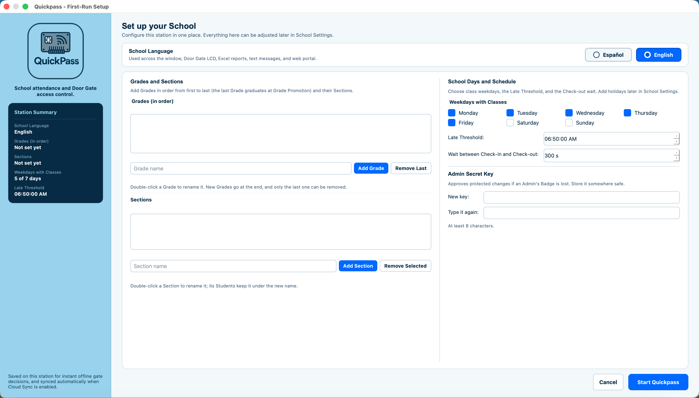

# Desktop Setup

How to install and start the Quickpass desktop program on the station computer at the School's entrance. The program shows the Quickpass window, talks to the Arduino over USB, decides who the Door Gate lets in, records Check-ins and Check-outs, and sends the Guardians' text messages.

## What you need

- A Windows or macOS computer. Nothing in Quickpass is specific to either, so Linux should work too.
- **Python 3.10 or newer.** Quickpass is developed and tested on Python 3.14.
- The Door Gate hardware, wired and flashed as described in the [Hardware Guide](hardware.md). You can try Quickpass without it in Demo Mode.
- Optional: a Supabase project, for Cloud Sync and the web portal. See [Web Portal Setup](web-portal-setup.md).
- Optional: a Twilio account, for text or WhatsApp messages to Guardians.

## 1. Get the code

Clone the repository, or download it as a ZIP file and unzip it:

```bash
git clone <repository URL> quickpass
cd quickpass
```

Run every command in this guide from the repository's root folder.

## 2. Create the Python environment

macOS or Linux:

```bash
python3 -m venv .venv
source .venv/bin/activate
pip install -r requirements.txt
```

Windows (Command Prompt):

```bat
python -m venv .venv
.venv\Scripts\activate
pip install -r requirements.txt
```

The window is built with Qt through `PySide6-Essentials`, the part of PySide6 that Quickpass needs. Activate the environment (the `activate` line above) in every new terminal before starting Quickpass.

## 3. Configure `.env`

Copy the template and edit the copy:

```bash
cp .env.example .env        # Windows: copy .env.example .env
```

`.env` holds this station's settings and secrets. Git ignores it, so never commit it or share it. A value set in the process environment wins over the same key in `.env`. Relative paths are resolved from the repository root.

The School's own policies aren't in `.env`. The School Language, the Grades and Sections, the school calendar, the Late Threshold, and the Admin Secret Key are School Settings, which you set in the window (step 5).

| Key | Default | What it does |
|:---|:---|:---|
| `SERIAL_PORT` | none | The Arduino's port, such as `COM3` on Windows or `/dev/cu.usbmodem11101` on macOS. Without it, Quickpass runs without the Arduino. |
| `SERIAL_BAUDRATE` | `9600` | Must match the firmware. Leave it at 9600. |
| `DATABASE_PATH` | `quickpass.db` | The station's local SQLite database. |
| `DATABASE_URL` | none | The PostgreSQL connection string of the School's Supabase database. Search and reports read the attendance history from it. Without it, they read this station's local database. |
| `SUPABASE_URL` | none | The Supabase project URL, for Cloud Sync. |
| `SUPABASE_SERVICE_ROLE_KEY` | none | The Supabase Service Role Key, for Cloud Sync. It bypasses Row-Level Security, so it belongs on stations only, never in the web portal. |
| `DEMO_MODE` | `false` | Demo Mode, for presentations and testing (see below). |
| `TWILIO_ENABLED` | `false` | Turns on the text messages. Messages go out only when it's `true` and the Twilio keys are filled in. |
| `TWILIO_USE_WHATSAPP` | `false` | Sends the messages over WhatsApp instead of SMS. |
| `TWILIO_ACCOUNT_SID`, `TWILIO_AUTH_TOKEN` | none | Your Twilio credentials. |
| `TWILIO_FROM_NUMBER` | none | The Twilio number the messages come from. |
| `ADMIN_ALERT_PHONE` | none | Gets an alert the first time each unregistered Badge is tapped on a day. |
| `WIPE_PASSWORD` | none | Required to wipe every Badge or the attendance history. Without it, wipes are refused. |
| `REPORTS_DIR` | `Reports` | The folder for the Excel reports. |

The web portal has its own `web/frontend/.env`, described in [Web Portal Setup](web-portal-setup.md).

If a value is malformed, such as `DEMO_MODE=maybe`, Quickpass names the key and the bad value and doesn't start.

### Finding the serial port

- In the Arduino IDE, the port is listed under **Tools > Port**.
- With `arduino-cli`, run `arduino-cli board list`.
- On Windows, open Device Manager and look under **Ports (COM & LPT)**.
- Run `python main_program/tools/diagnostic.py` with no `SERIAL_PORT` set, and it lists the ports it sees.

## 4. Start Quickpass

With the environment active:

```bash
python main_program/main.py
```

The label at the bottom of the sidebar shows whether the Arduino is connected. If it isn't, Quickpass keeps trying every few seconds, so you can plug it in after starting. Close the Arduino IDE's Serial Monitor first: only one program can hold the port.

## 5. First-run setup

The first time Quickpass starts on a station, it looks for the School Settings: first in the station's database, then in Supabase if Cloud Sync is set up. If a station is joining a School that's already set up in Supabase, Quickpass downloads the settings and skips the setup window. If Supabase is set up but can't be reached, Quickpass says so and closes; check the internet connection, `SUPABASE_URL`, and `SUPABASE_SERVICE_ROLE_KEY`, then start it again.


Otherwise the first-run setup window opens, where all initial policies are configured on a single screen:



1. **School Language:** Spanish or English. Everything the School's people see uses it: the window, the Door Gate's LCD, the reports, the text messages, and the web portal.
2. **Grades and Sections:** the School's Grades in order, first to last, and the Sections they're divided into, such as A and B. The last Grade is the one whose Students graduate at the Grade Promotion.
3. **School Days and Schedule:** the weekdays with classes, the Late Threshold (a Check-in after it counts as Late), and the wait between a Check-in and a Check-out. Holidays are added afterwards in School Settings.
4. **Admin Secret Key:** a secret of at least 8 characters that can stand in for an Admin's Badge to approve protected changes, for example if the Admin's Badge is lost. Keep it somewhere safe.

All of these can be changed later in the School Settings view. Next, register the first Admin's Badge, as described in [School Administration](school-administration.md).

## Demo Mode

With `DEMO_MODE=true`:

- each person's taps alternate between Check-in and Check-out, with no wait between them and no daily limit;
- a typed Badge UID can stand in for a tap, wherever Quickpass asks for a Badge;
- the Live Access window shows buttons that simulate a scan or an unregistered Badge;
- no text messages are sent.

Use it for demonstrations and testing, never at a real entrance.

## Text messages (Twilio)

When `TWILIO_ENABLED=true` and the Twilio keys are filled in, Quickpass sends:

- each Student's Guardians a message when the Student checks in (saying whether they're on time or late) and when they check out;
- `ADMIN_ALERT_PHONE` an alert the first time each unregistered Badge is tapped on a day.

Messages are written in the School Language and sent in the background, so the Door Gate never waits for them. Check the Twilio configuration with:

```bash
python main_program/tools/test_sms.py --phone "+1 555 123 4567"
```

Without `--phone`, the test message goes to `ADMIN_ALERT_PHONE`.

## Other tools

| Command | What it does |
|:---|:---|
| `python main_program/tools/diagnostic.py [--port PORT] [--baud BAUD]` | Shows what the Arduino sends and sends it test commands. See the [Hardware Guide](hardware.md#checking-the-board). |
| `./main_program/tools/flash.sh [PORT]` | Compiles the firmware and uploads it to an Arduino Uno with `arduino-cli`. |
| `python main_program/tools/test_sms.py [--phone PHONE] [--message TEXT]` | Sends a test text message through Twilio. |
| `python main_program/tools/generator.py [--db PATH] [--students 30] [--teachers 6] [--days 5] [-y]` | Fills a database with fake people and a few days of attendance, for trying Quickpass out. |

> [!WARNING]
> The generator writes into the database in `DATABASE_PATH` unless you give `--db`, and that database must already have School Settings. Cloud Sync would send the fake people and scans to Supabase. Use it only with a separate test database, on a station whose `.env` has no Supabase keys. For example, set `DATABASE_PATH=demo.db`, run Quickpass once to finish first-run setup, close it, and then run the generator.

## Updating Quickpass

1. Back up the station's database file (`DATABASE_PATH`).
2. Get the new code with `git pull`, or download it again.
3. Run `pip install -r requirements.txt` with the environment active.
4. If the update adds files to `supabase/migrations/`, apply them as described in [Web Portal Setup](web-portal-setup.md#2-create-the-database).
5. If the update changes the firmware (`main_program/main_program.ino` or its `.h` files), upload it again.

## Troubleshooting

| What you see | What to check |
|:---|:---|
| `Missing Python package 'PySide6'` (or `No module named 'PySide6'`) | Activate `.venv` (`source .venv/bin/activate` or `.venv\Scripts\activate`) and run `pip install -r requirements.txt`, or run `make demo` / `make run`. |
| `Invalid value for KEY in .env: ...` | Fix the named key in `.env`. |
| The sidebar keeps saying it's searching for the Arduino | `SERIAL_PORT`, the USB cable, and that no other program has the port open. |
| `Could not open <port>` | Another program has the port, such as the Serial Monitor, or the port name is wrong. |
| Searches show only recent days | Search and reports read the history from Supabase through `DATABASE_URL`. Cloud Sync removes the scans it has sent from the station's database once their day has passed. |
| Guardians get no messages | `TWILIO_ENABLED`, the Twilio keys, `DEMO_MODE` (no messages in Demo Mode), and the Guardians' phone numbers. Try `test_sms.py`. |
